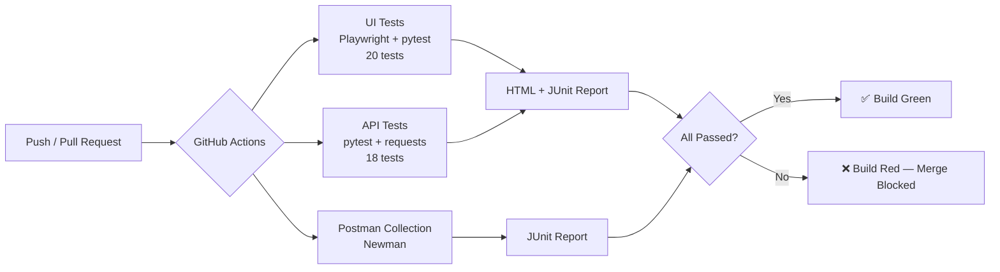
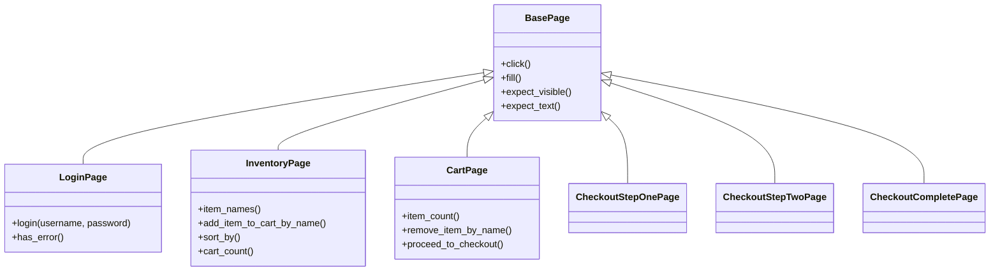
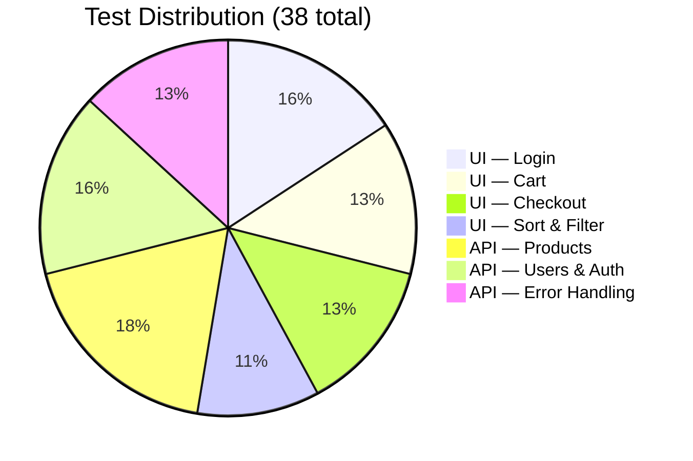

<div align="center">

<!-- Animated gradient banner — renders as a real animated SVG on GitHub -->


<!-- Animated typing subtitle -->
<a href="#">
  
</a>

<br/><br/>

<!-- Live status badges -->


<br/>

**A full QA engineering portfolio project** — UI automation, API automation,
CI/CD gatekeeping, and structured test reporting, built across two live
target applications.

</div>

> ⚠️ **One-time setup:** replace `YOUR_USERNAME/YOUR_REPO` in the CI badge
> URL at the top of this file (and in the clone command further down) with
> your actual GitHub path once pushed — that's what turns the badge from a
> placeholder into a live, auto-updating one.

---

## 📑 Table of Contents

- [Overview](#-overview)
- [Project Structure](#-project-structure)
- [Architecture](#%EF%B8%8F-architecture)
- [Test Coverage](#-test-coverage)
- [Tech Stack](#-tech-stack)
- [Getting Started](#-getting-started)
- [Running the Tests](#-running-the-tests)
- [Test Reporting](#-test-reporting)
- [CI/CD Pipeline](#%EF%B8%8F-cicd-pipeline)
- [Scope](#-scope)
- [Known Findings](#-known-findings)
- [Documentation](#-documentation)
- [Author](#-author)

---

## 🔍 Overview

This repository demonstrates end-to-end QA engineering practice across two
real, live applications under test:

| Target | Type | URL |
|---|---|---|
| **SauceDemo** | E-commerce UI | https://www.saucedemo.com |
| **DummyJSON** | Public REST API | https://dummyjson.com |

It covers the full QA lifecycle a working QA engineer is expected to own:
writing maintainable UI tests with a proper design pattern, writing API
contract tests, mirroring them in Postman for cross-tool coverage, wiring
everything into a CI pipeline that actually blocks bad builds, generating
inspectable test reports, and documenting scope and known bugs like a real
test plan — not just a folder of scripts.

**Current status: 38 / 38 tests passing.**

---

## 📂 Project Structure

```
qa-test-suite/
├── .github/
│   └── workflows/
│       └── ci.yml                  # 3 parallel CI jobs: UI, API, Postman
├── ui-tests/
│   ├── conftest.py                 # Playwright fixtures (browser, page, login)
│   ├── pytest.ini                  # UI suite config
│   ├── pages/                      # Page Object Model
│   │   ├── base_page.py
│   │   ├── login_page.py
│   │   ├── inventory_page.py
│   │   ├── cart_page.py
│   │   └── checkout_page.py
│   └── tests/
│       ├── test_login.py
│       ├── test_cart.py
│       ├── test_checkout.py
│       └── test_sort_and_filter.py
├── api-tests/
│   ├── conftest.py                 # requests session fixtures
│   ├── pytest.ini                  # API suite config
│   └── tests/
│       ├── test_products.py
│       ├── test_users.py
│       └── test_errors.py
├── postman/
│   └── DummyJSON.postman_collection.json
├── docs/
│   ├── TEST_PLAN.md                # scope, environment, how to run
│   ├── BUG_REPORTS.md              # 5 documented findings
│   └── MANUAL_STEPS_CHECKLIST.md   # portfolio/resume publishing checklist
├── pytest.ini                       # root config — run everything at once
├── requirements.txt
├── .gitignore
└── README.md
```

---

## 🗺️ Architecture

How a push flows through the pipeline, end to end:



The UI suite follows the **Page Object Model**: each page of SauceDemo
(login, inventory, cart, checkout) is its own class exposing intent-revealing
methods (`login()`, `add_item_to_cart_by_name()`, `proceed_to_checkout()`),
so tests read like user stories instead of raw Playwright calls, and a
selector change only needs fixing in one place.



---

## ✅ Test Coverage



### UI Suite — 20 tests (`ui-tests/`)
| Area | What's covered |
|---|---|
| **Login** | Valid login, invalid password, locked-out user, empty username, empty password, unknown username |
| **Cart** | Add single item, add multiple items (badge count accuracy), cart contents listing, item removal, empty-cart state |
| **Checkout** | Full happy-path checkout, tax/total calculation correctness, required-field validation (first name, last name, postal code) |
| **Sort & Filter** | Name A→Z, name Z→A, price low→high, price high→low |

### API Suite — 18 tests (`api-tests/`)
| Area | What's covered |
|---|---|
| **Products** | List all, single-record fetch, schema validation, field-type validation, category filter, `limit` query param, nonexistent ID (404), non-numeric ID handling |
| **Users & Auth** | List all users, schema validation, user creation, login with valid credentials, login with invalid credentials, login with missing password field |
| **Error Handling** | Missing required fields, malformed JSON body, negative IDs, deleting nonexistent records, unsupported HTTP methods — all asserting no 5xx server crash |

### Postman Collection (`postman/`)
Mirrors the happy-path and negative API coverage above as a standalone
collection, runnable via **Newman** — useful for interviewers who
specifically ask about Postman experience, and as cross-tool validation
that the API contract assertions aren't pytest-specific quirks.

---

## 🧰 Tech Stack

<div align="left">


</div>

| Layer | Tool | Why |
|---|---|---|
| UI automation | **Playwright** (sync API) | Fast, reliable, auto-waiting browser automation |
| Test runner | **pytest** | Industry-standard, marker-based filtering, fixture system |
| API client | **requests** | Simple, explicit HTTP assertions |
| API cross-check | **Postman / Newman** | Second, independent verification path |
| CI/CD | **GitHub Actions** | Free, native to GitHub, runs on every push/PR |
| Reporting | **pytest-html** + JUnit XML | Human-readable report + machine-readable CI artifact |

---

## 🚀 Getting Started

```bash
# 1. Clone and enter the project
git clone https://github.com/YOUR_USERNAME/YOUR_REPO.git
cd YOUR_REPO

# 2. Create and activate a virtual environment
python -m venv .venv
source .venv/bin/activate        # Windows: .venv\Scripts\activate

# 3. Install dependencies
pip install -r requirements.txt

# 4. Install Playwright's browser binary (one-time, ~1 min)
python -m playwright install --with-deps chromium
```

---

## 🧪 Running the Tests

```bash
# Run everything (all 38 tests) from the repo root
pytest

# Run only the fast smoke subset, across both suites
pytest -m smoke

# Run a suite on its own
cd ui-tests && pytest && cd ..
cd api-tests && pytest && cd ..

# Run only negative/error-path tests
pytest -m negative

# Watch the browser instead of running headless (UI suite)
cd ui-tests && pytest --headed
```

**Markers** (shared across both suites):
| Marker | Meaning |
|---|---|
| `smoke` | Fast, critical-path checks |
| `regression` | Full functional coverage |
| `negative` | Invalid-input / error-path checks |

---

## 📊 Test Reporting

```bash
# Self-contained HTML report (open in any browser)
pytest --html=report.html --self-contained-html

# JUnit XML (for CI dashboards / badges)
pytest --junitxml=results.xml
```

Every CI run uploads both formats as downloadable artifacts — pass or fail —
so results are inspectable beyond just the green/red badge.

```bash
# Postman / Newman, with the same reporting pattern
newman run postman/DummyJSON.postman_collection.json --reporters cli,junit --reporter-junit-export postman/newman-results.xml
```

---

## ⚙️ CI/CD Pipeline

`.github/workflows/ci.yml` runs **three parallel jobs** on every push and
every pull request:

1. **UI Tests** — Playwright + pytest, headless Chromium
2. **API Tests** — pytest + requests
3. **Newman** — the Postman collection

Any single test failure fails its job — nothing is suppressed — so a red
build genuinely blocks a merge rather than silently passing. HTML and JUnit
reports are uploaded as CI artifacts on every run regardless of outcome.

---

## 🎯 Scope

<details>
<summary><b>✅ In scope (click to expand)</b></summary>

- Login: valid login, invalid password, locked-out user, empty required fields, unknown user
- Cart: add single/multiple items, badge count accuracy, cart contents, item removal, empty-cart state
- Checkout: full happy-path checkout, tax/total calculation, required-field validation
- Sort/filter: name A–Z/Z–A, price low–high/high–low
- API Products: list, detail, schema validation, category filter, `limit` param, invalid/nonexistent IDs
- API Users/Auth: list, schema validation, user creation, login (valid/invalid/missing credentials)
- API Errors: malformed JSON, negative IDs, unsupported HTTP methods, deleting nonexistent records

</details>

<details>
<summary><b>🚫 Out of scope (click to expand)</b></summary>

- Cross-browser matrix (Chromium only — Firefox/WebKit not covered)
- Performance/load testing
- Visual regression / pixel-diff testing
- Mobile viewport testing
- Accessibility (a11y) auditing
- Security testing beyond basic negative-input handling
- Database-level verification (both targets are black-box/third-party)

</details>

> **Note on "search and filter":** SauceDemo has no free-text search box.
> Its equivalent is the product **sort** dropdown, covered in
> `test_sort_and_filter.py` as the stand-in for that roadmap item.

Full detail in [`docs/TEST_PLAN.md`](docs/TEST_PLAN.md).

---

## 🐛 Known Findings

5 documented findings with repro steps and severity, including real seeded
bugs on SauceDemo's test accounts and a DummyJSON API contract gotcha
(write endpoints don't actually persist data) — see
[`docs/BUG_REPORTS.md`](docs/BUG_REPORTS.md).

---

## 📚 Documentation

| File | Contents |
|---|---|
| [`docs/TEST_PLAN.md`](docs/TEST_PLAN.md) | Objective, scope in/out, environment notes, full run instructions |
| [`docs/BUG_REPORTS.md`](docs/BUG_REPORTS.md) | 5 findings with repro steps, severity, and impact |
| [`docs/MANUAL_STEPS_CHECKLIST.md`](docs/MANUAL_STEPS_CHECKLIST.md) | Portfolio/resume publishing checklist |

---

## 👤 Author

Built as a QA automation portfolio project demonstrating UI automation, API
testing, CI/CD gatekeeping, and QA documentation practice.

<div align="center">

</div>